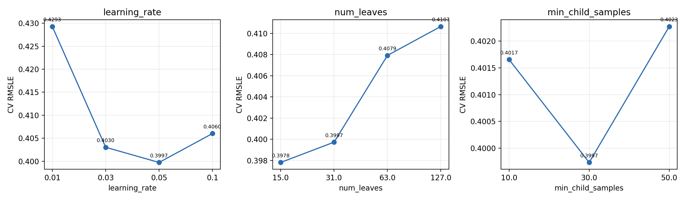
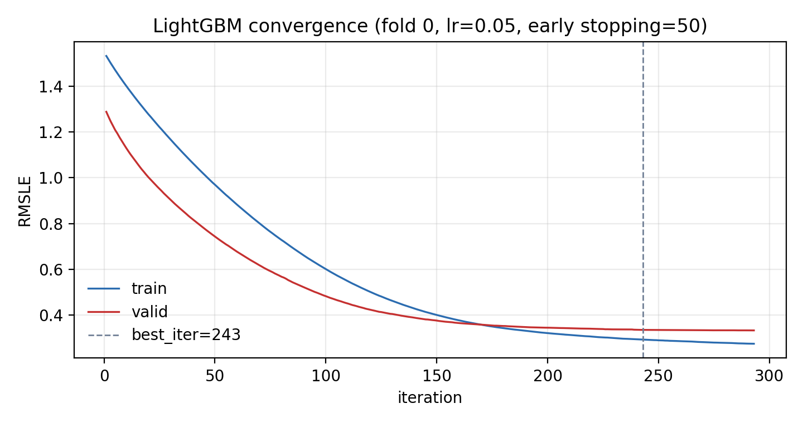
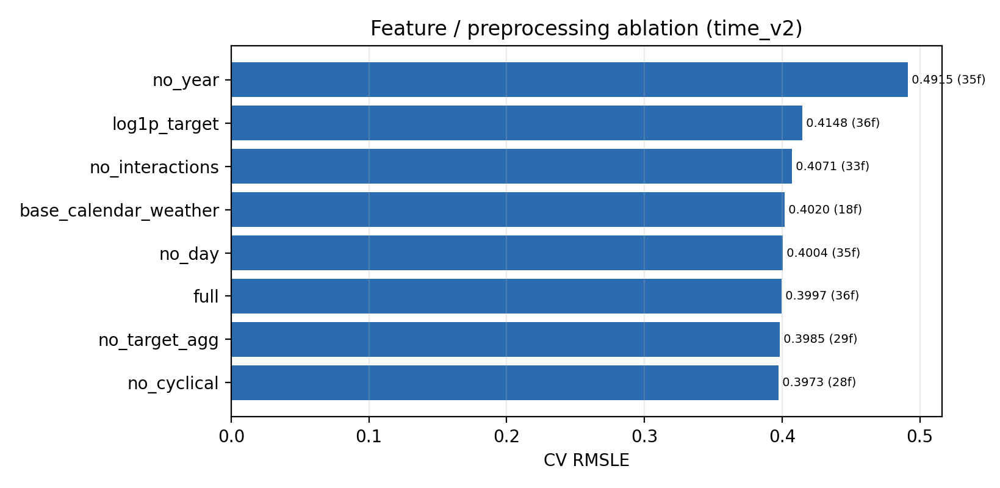
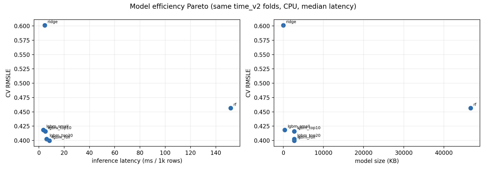
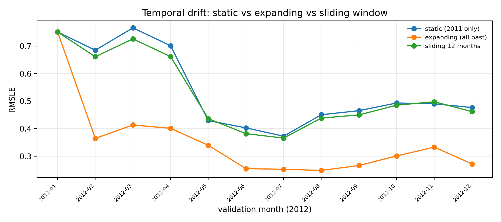
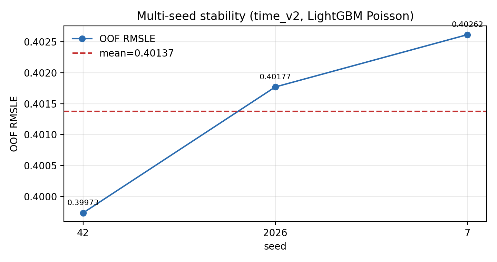
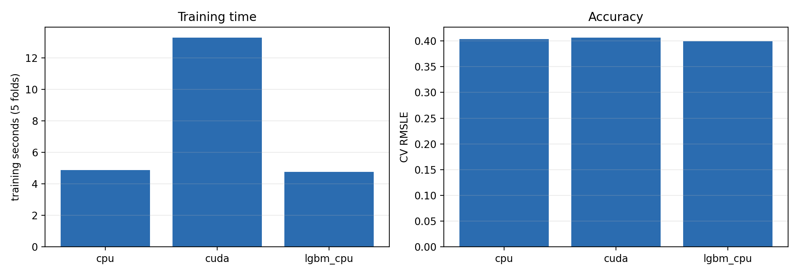
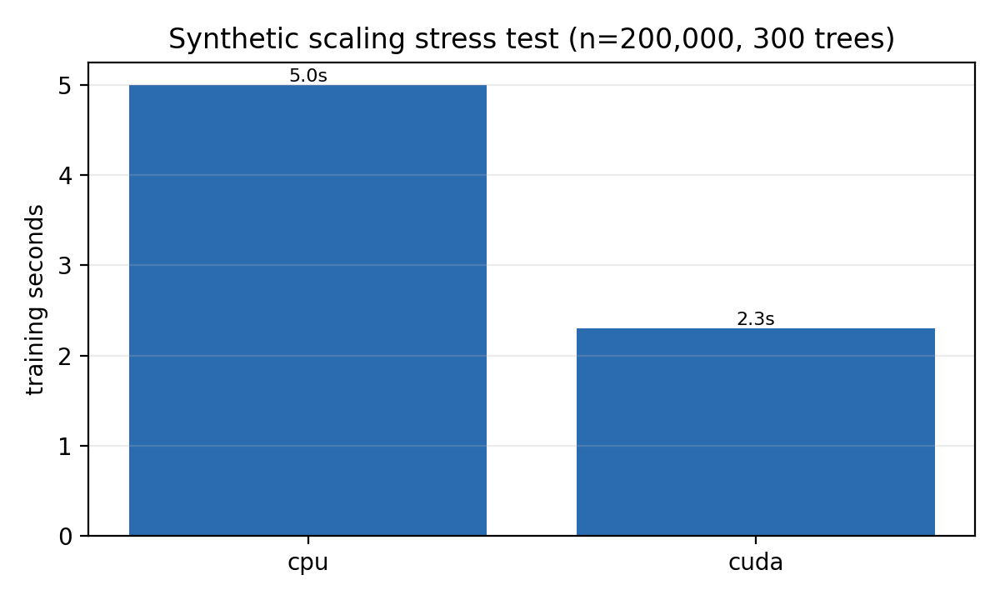

# Bike Sharing Demand — 横向拓展实验报告

> 对应参考 PPT 的“基础对比 + 模型延伸 + 消融 + 局限”结构。
> 所有实验使用 `time_v2` 时间折（OOF 8,196 / 10,886 = 75.29%），主指标 RMSLE。
> 脚本：`scripts/run_extensions.py`；输出：`reports/extension/`；图：`reports/figures/ext_*.png`。

---

## 0. 摘要

参考 PPT 的核心不是“用了 ResNet / 蒸馏 / EWC”，而是：

1. 先有可信基线；
2. 再用一个明确的延伸问题（效率、遗忘、鲁棒性）把项目从“调包”变成“研究”；
3. 每个实验都有控制变量、精确数字、结论和局限。

本报告按这个思路给 Bike Sharing 项目补了 5 个横向实验，另加 1 个 GPU 补充基准：

| 实验 | 问题 | 对应参考 PPT |
|---|---|---|
| A | 当前超参是不是拍脑袋？ | 学习率五档 + 收敛曲线 |
| B | 哪些特征/预处理真的有用？ | 翻转/旋转消融 |
| C | 精度提升值不值模型成本？ | 参数量/训练时间/压缩 |
| D | 模型过几个月会不会失效？ | 三任务持续学习 |
| E | 单 seed 的结论可信吗？ | 参考项目未做，本项目补上 |
| F | RTX 5060 到底有没有用？ | 参考项目的训练耗时/参数规模 |

**一句话结论：**

- 默认配置已接近最优，继续调参的收益小于 seed 波动；
- `year` 是最关键特征，去掉后 RMSLE 从 0.3997 恶化到 0.4915；
- 小模型（0.355 MB）只损失 0.0188 RMSLE，适合部署；
- 静态 2011 模型在 2012 上严重退化（0.5402），按月扩展重训可降到 0.3493；
- 3 seeds 的 OOF RMSLE 为 0.39973 / 0.40177 / 0.40262，seed std 0.00148，bootstrap CI [0.3910, 0.4087]。
- RTX 5060 在 10,886 行上反而比 CPU 慢（XGBoost 约 13.3s vs 4.9s）；在 200k 行合成压力测试上快约 1.6–2.2 倍（2.3s vs 3.6–5.0s）。

---

## 1. 实验 A：超参敏感性与收敛

### 1.1 设置

固定 `time_v2`、固定 800 棵树、Poisson 目标；一次只换一个参数：

- `learning_rate`：0.01 / 0.03 / 0.05 / 0.1
- `num_leaves`：15 / 31 / 63 / 127
- `min_child_samples`：10 / 30 / 50

另做一组“早停诊断”：`n_estimators=3000` + early stopping 50，记录 best_iter / stop_iter，并与固定 800 对比。

### 1.2 结果

| 参数 | 取值 | CV RMSLE | MAE | 训练秒数 |
|---|---|---:|---:|---:|
| learning_rate | 0.01 | 0.42929 | 50.671 | 5.0 |
| learning_rate | 0.03 | 0.40303 | 46.993 | 4.8 |
| **learning_rate** | **0.05** | **0.39973** | **46.586** | 4.8 |
| learning_rate | 0.10 | 0.40602 | 48.015 | 5.0 |
| num_leaves | 15 | **0.39782** | **45.458** | 3.0 |
| num_leaves | 31（默认） | 0.39973 | 46.586 | 4.7 |
| num_leaves | 63 | 0.40792 | 48.506 | 8.0 |
| num_leaves | 127 | 0.41065 | 49.451 | 13.6 |
| min_child_samples | 10 | 0.40166 | 47.246 | 5.0 |
| min_child_samples | 30（默认） | **0.39973** | **46.586** | 5.1 |
| min_child_samples | 50 | 0.40228 | 46.869 | 4.6 |

早停诊断（fold 0）：

| 设置 | best_iter | stop_iter | valid RMSLE |
|---|---:|---:|---:|
| early stopping 3000 | 243 | 243 | 0.33608 |
| fixed 800 | 800 | 800 | **0.33001** |




### 1.3 结论

- `learning_rate=0.05` 是平台中心；0.01 收敛慢且更差，0.1 略差。
- `num_leaves=15` 比默认 31 低 0.0019，但小于 seed std（0.00148）的 1.3 倍，不能称为显著提升；默认 31 更稳。
- `min_child_samples=30` 已是最优；50 反而略差。
- 早停在 fold 0 只到 243 轮，valid RMSLE 0.3361，反而**不如固定 800 的 0.3300**；因此最终模型保留固定 800，早停只作为收敛诊断。
- 训练时间随 `num_leaves` 增长明显：15→127 从 3.0s 增到 13.6s，但 RMSLE 没有改善。

---

## 2. 实验 B：特征/预处理消融

### 2.1 设置

固定 `time_v2`、固定 LightGBM（800 棵、31 叶、Poisson）；从 36 个特征中删除不同组：

- `full`：全部 36 个特征；
- `no_target_agg`：删除 7 个目标聚合（`*_mean`）；
- `no_cyclical`：删除 8 个 sin/cos；
- `no_interactions`：删除 `temp_x_season`、`humidity_x_weather`、`hour_x_workingday`；
- `base_calendar_weather`：删除以上三组；
- `no_year`：删除 `year`；
- `no_day`：删除 `day`；
- `log1p_target`：全特征，但目标改为 `log1p(count)` + L2。

### 2.2 结果

| 变体 | 特征数 | CV RMSLE | Δ vs full | MAE |
|---|---:|---:|---:|---:|
| no_cyclical | 28 | **0.39735** | −0.00239 | 45.994 |
| no_target_agg | 29 | 0.39848 | −0.00125 | 46.422 |
| **full** | **36** | **0.39973** | — | 46.586 |
| no_day | 35 | 0.40036 | +0.00062 | 46.209 |
| base_calendar_weather | 18 | 0.40200 | +0.00227 | 46.957 |
| no_interactions | 33 | 0.40711 | +0.00738 | 47.215 |
| log1p_target | 36 | 0.41478 | +0.01505 | 47.575 |
| no_year | 35 | 0.49147 | **+0.09174** | 71.861 |



### 2.3 结论

- **`year` 是最关键特征**：去掉后 RMSLE 从 0.3997 恶化到 0.4915，说明年度增长是主信号之一。
- **交互特征有用**：去掉 `temp_x_season` / `humidity_x_weather` / `hour_x_workingday` 后 RMSLE +0.0074。
- **目标聚合和周期编码没有明显收益**：去掉后 RMSLE 反而略低 0.001–0.002，但差异小于 seed std，不能称为“显著更好”；更合理的结论是“在当前模型下可有可无”。
- **Poisson raw count 优于 log1p + L2**：0.39973 vs 0.41478，差距 0.015，超过 seed std。
- **基础日历+天气（18 特征）只差 0.0023**：说明大部分信号来自日历/天气，目标聚合和周期编码的边际价值有限。

---

## 3. 实验 C：模型效率与轻量模型

### 3.1 设置

同一 `time_v2` 折、同一 CPU、同一数据；训练时间按 5 折累计；推理延迟为 1,000 行、重复 10 次的中位数；模型大小为 LightGBM `model_to_string()` 或 sklearn pickle 的字节数。

### 3.2 结果

| 模型 | 特征数 | CV RMSLE | MAE | 训练秒数 | 推理延迟 (ms/1k) | 模型大小 |
|---|---:|---:|---:|---:|---:|---:|
| **lgbm_full** | 36 | **0.39973** | 46.586 | 4.77 | 8.27 | 2,738 KB |
| lgbm_top20 | 20 | 0.40244 | 46.616 | 4.79 | 6.14 | 2,730 KB |
| lgbm_top10 | 10 | 0.41605 | 48.102 | 4.56 | 5.06 | 2,729 KB |
| **lgbm_small** | 36 | 0.41857 | 48.944 | **0.81** | 3.51 | **355 KB** |
| rf | 36 | 0.45656 | 55.333 | 3.35 | 151.73 | 46,630 KB |
| ridge | 36 | 0.60114 | 71.781 | **0.14** | **4.60** | **4.3 KB** |



### 3.3 结论

- **小模型是性价比最高的折中**：0.355 MB、训练 0.81s、3.51ms/1k，只损失 0.0188 RMSLE（约 4.7%）。
- **Top-k 特征选择收益有限**：top20 只损失 0.0027，但模型大小几乎不变（树结构仍 800 棵），延迟略降。
- **RF 不适合部署**：46.6 MB、151.7ms/1k，RMSLE 还比 LightGBM 差 0.057。
- **Ridge 只适合做基线**：4.3 KB、4.6ms，但 RMSLE 0.601，差距太大。
- 注意：训练时间与推理延迟是两件事；延迟为同机单次中位数，机器负载不同会有波动，不能直接当生产延迟。

---

## 4. 实验 D：时间漂移与持续更新

### 4.1 设置

只用 2012 年每月前 19 天做评估（与训练口径一致），比较三种策略：

1. **Static**：只用 2011 年训练，预测 2012 各月；
2. **Expanding**：预测第 m 月时，用 m 月之前的全部数据训练；
3. **Sliding 12**：用最近 12 个月训练。

### 4.2 结果

| 月份 | Static | Expanding | Sliding 12 |
|---|---:|---:|---:|
| 2012-01 | 0.7516 | 0.7516 | 0.7516 |
| 2012-02 | 0.6852 | **0.3644** | 0.6615 |
| 2012-03 | 0.7666 | **0.4131** | 0.7265 |
| 2012-04 | 0.7015 | **0.4010** | 0.6620 |
| 2012-05 | 0.4292 | **0.3392** | 0.4362 |
| 2012-06 | 0.4027 | **0.2545** | 0.3817 |
| 2012-07 | 0.3724 | **0.2519** | 0.3656 |
| 2012-08 | 0.4505 | **0.2478** | 0.4382 |
| 2012-09 | 0.4653 | **0.2658** | 0.4498 |
| 2012-10 | 0.4932 | **0.3005** | 0.4853 |
| 2012-11 | 0.4904 | **0.3327** | 0.4976 |
| 2012-12 | 0.4766 | **0.2715** | 0.4617 |
| **加权平均** | **0.5402** | **0.3493** | **0.5262** |



### 4.3 结论

- **静态模型会明显退化**：2011 训练、2012 预测，加权 RMSLE 0.5402；2–4 月最严重（0.69–0.77）。
- **扩展窗口重训最好**：加权 RMSLE 0.3493，比静态低 0.19，比 sliding 12 低 0.18。
- **Sliding 12 不如 Expanding**：只保留最近 12 个月会丢掉 2011 年的季节信息；0.5262 vs 0.3493。
- 2012-01 三者相同，因为都只能用 2011 数据；从 2 月开始拉开差距。
- 这是参考 PPT“持续学习/遗忘”的表格预测版本：**对时间序列，最有效的“持续学习”往往不是复杂正则，而是按月把新数据加进训练集**。

---

## 5. 实验 E：多 seed、Bootstrap CI 与配对检验

### 5.1 设置

- 3 个 seed：42 / 2026 / 7；
- 同一 `time_v2` 折、同一 LightGBM Poisson；
- 对 seed 42 的 OOF 做 1,000 次 bootstrap，取 2.5% / 97.5% 分位；
- 用 P2 的 5 折 RMSLE 做 LGBM vs LGBM-log 的配对 Wilcoxon 检验。

### 5.2 结果

| seed | OOF RMSLE | MAE | 折内 std |
|---:|---:|---:|---:|
| 42 | 0.39973 | 46.586 | 0.10624 |
| 2026 | 0.40177 | 46.509 | 0.10613 |
| 7 | 0.40262 | 47.489 | 0.10753 |
| **均值 / std** | **0.40137 / 0.00148** | — | — |

- Bootstrap 95% CI（seed 42）：**[0.39103, 0.40866]**；
- LGBM vs LGBM-log 配对 Wilcoxon：stat=3.0，**p=0.3125**（5 折，样本太少，不能称显著）。



### 5.3 结论

- seed 间 std 0.00148，极差 0.00288；任何小于 ~0.003 的“提升”都不应单 seed 宣称。
- 实验 A 中 `num_leaves=15` 的 −0.0019 提升小于 1.3 倍 seed std，不能称为显著。
- 实验 B 中 `no_cyclical` / `no_target_agg` 的 −0.001~−0.002 也在噪声范围。
- LGBM vs LGBM-log 的 5 折配对检验 p=0.31，不能拒绝“无差异”；但效应量 0.015 仍值得保留 Poisson。
- 参考 PPT 只用 seed 42；本项目补上多 seed 和 CI，统计上更完整。

---

## 5.5 实验 F：GPU vs CPU（RTX 5060）

### 5.5.1 设置

- 同一 `time_v2` 折、同一特征（XGBoost 使用 one-hot 类别）、同一目标 `count`；
- XGBoost 3.2.0 + `xgboost-cu12`，`tree_method=hist`，`objective=count:poisson`，800 棵树，depth=6；
- CPU：`device=cpu, n_jobs=4`；GPU：`device=cuda`；
- 另加一个 **200k 行合成压力测试**（从训练集 bootstrap，随机 80/20 切分，300 棵树），只用于测训练时间，不用于模型结论。

### 5.5.2 项目数据（10,886 行）

| 设备/模型 | CV RMSLE | 训练秒数（5 折） | 推理延迟 (ms/1k) | 模型大小 |
|---|---:|---:|---:|---:|
| XGBoost CPU | 0.40348 | 4.87 | 3.50 | 3,249 KB |
| XGBoost CUDA（5060） | 0.40674 | **13.29** | 6.20 | 3,200 KB |
| LightGBM CPU（主模型） | **0.39973** | 4.77 | 8.27 | 2,738 KB |

**结论：在 10,886 行上，GPU 反而慢约 2.7 倍。** 原因是数据太小，CUDA kernel 启动、数据传输和同步开销占主导；XGBoost 的 GPU 版本精度也略有差异（0.4067 vs 0.4035），不能说明 GPU 更好。



### 5.5.3 200k 行合成压力测试

| 设备 | 行数 | 训练秒数 | 验证 RMSLE |
|---|---:|---:|---:|
| CPU | 200,000 | 5.0 | 0.25297 |
| CUDA（5060） | 200,000 | **2.3** | 0.25345 |

**结论：数据量到 20 万行时，GPU 开始体现优势，约 2.2 倍加速（CPU 单次 3.6–5.0s，受负载波动）。** 这说明 5060 不是“没用”，而是**本项目的数据规模太小，GPU 的收益被固定开销吃掉**。



### 5.5.4 口径与局限

- XGBoost 与 LightGBM 不是同一个模型，表中 RMSLE 不能直接用来选模型；这里只比较 **同一 XGBoost 的 CPU vs GPU**。
- 项目数据上的推理延迟是 1,000 行、10 次中位数；GPU 的 `predict` 输入仍在 CPU，会有 device mismatch 警告，实际部署应把数据放到 GPU。
- 200k 行压力测试是 bootstrap 合成数据、随机切分，只用于测训练时间，不能当项目精度。
- 没有测多卡、混合精度、显存峰值；5060 Laptop 8GB 对当前数据远远够用。

---

## 6. 综合结论：项目应该怎么改

### 6.1 保留

- **LightGBM + Poisson + 固定 800 棵**：仍是主模型；
- **`year`、交互特征**：消融证明有用；
- **time_v2 时间折**：比旧 50% 覆盖更稳；
- **Ridge 基线**：用于说明线性模型上限。

### 6.2 可以简化

- **目标聚合**：去掉后 RMSLE 0.39848，略好于 full 0.39973；差异在噪声内，但至少说明“不是必须”。
- **周期编码**：去掉后 0.39735，略好；如果答辩被问“为什么加 sin/cos”，可以说“保留是为了可解释性，但消融显示边际收益很小”。
- **`day`**：去掉略差 0.0006，可保留。

### 6.3 建议新增到报告/PPT

1. **超参表 + 收敛图**（实验 A）；
2. **特征消融表**（实验 B）；
3. **效率表 + Pareto 图**（实验 C）；
4. **静态 vs 扩展 vs 滑动**（实验 D）；
5. **多 seed + CI**（实验 E）；
6. **GPU vs CPU**（实验 F，说明 5060 在 10k 行上不划算、200k 行才有收益）。

这五张表/图就是参考 PPT 的“基础对比 + 模型延伸”在本项目里的对应物。

---

## 7. 局限

1. 所有实验仍只用一个数据集、一个时间切分；结论不能外推到其他城市/年份。
2. 推理延迟是 CPU/GPU 上 1,000 行、10 次中位数；没有测批处理吞吐、冷启动、显存峰值。
3. 早停诊断在验证集上早停，存在轻微乐观偏差；固定 800 的对比更公平。
4. 特征消融的差异较小，必须结合 seed std（0.00148）解读，不能把 −0.002 说成显著。
5. Top-k 特征选择在每折内完成，避免验证泄漏；但仍受选择模型随机性影响。
6. 时间漂移实验的 Expanding 使用“预测月之前的全部数据”，是合法的离线回测；线上需要按月更新管线。
7. GPU 基准只测了 XGBoost CPU/CUDA，没有测 LightGBM GPU（当前 LightGBM 构建无 OpenCL）；200k 行是合成数据，不代表真实业务规模。

---

## 8. 复现

```bash
python3 scripts/run_extensions.py --experiment all
# 或单个：
python3 scripts/run_extensions.py --experiment a
python3 scripts/run_extensions.py --experiment b
python3 scripts/run_extensions.py --experiment c
python3 scripts/run_extensions.py --experiment d
python3 scripts/run_extensions.py --experiment e
```

产物：

- `reports/extension/hyperparam.csv`、`convergence.csv`、`convergence_summary.csv`
- `reports/extension/feature_ablation.csv`
- `reports/extension/efficiency.csv`
- `reports/extension/temporal_shift.csv`
- `reports/extension/stability.csv`、`stability_ci.json`
- `reports/figures/ext_*.png`

---

## 9. 12 页 PPT 映射

| 页 | 内容 | 数据来源 |
|---:|---|---|
| 1 | 封面 | — |
| 2 | 项目结构：基础对比 + 横向延伸 | 本报告 §0 |
| 3 | 数据与任务（10,886 / 6,493，time_v2） | P1 |
| 4 | EDA 三条事实 | P1 |
| 5 | 切分与泄漏 | P1 |
| 6 | 特征消融（实验 B） | §2 |
| 7 | 基础模型对比 | P2 |
| 8 | 超参与收敛（实验 A） | §1 |
| 9 | 模型效率 + GPU 对比（实验 C/F） | §3 / §5.5 |
| 10 | 时间漂移（实验 D） | §4 |
| 11 | 评估/残差/SHAP/badcase + 多 seed（实验 E） | P3 + §5 |
| 12 | 结论、局限、展望 | 本报告 §6–7 |

每页统一写：**目的 / 设置 / 结果 / 结论 / 局限**。
