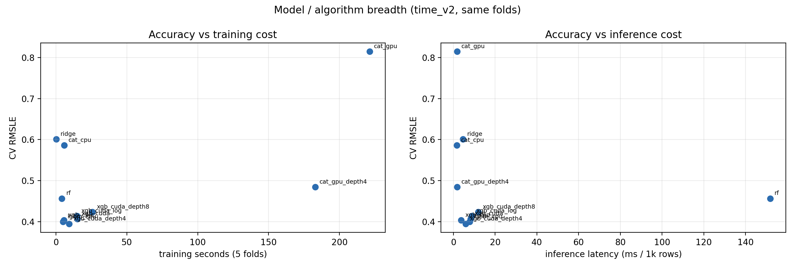

# 模型 / 算法宽度对比（GPU 素材）

> 用途：答辩 PPT 第 9 页“模型效率 + GPU + 模型族宽度”、P2 报告横向拓展章节、答辩问答素材。
> 数据：Bike Sharing Demand，`time_v2` 时间折，OOF 8,196 / 10,886（75.29%）。
> 主指标：RMSLE（越低越好）。所有预测裁剪到 `>= 0`。

## 1. 实验协议

| 项 | 设置 |
|---|---|
| 数据 | `data/processed/train.parquet`，10,886 行；测试 6,493 行 |
| 切分 | `splits/time_folds.json`（time_v2，5 折 expanding-window） |
| 目标 | `count`（每小时租车量） |
| 树模型 | 800 轮 / 学习率 0.05 / 深度 6 或 31 叶 |
| LightGBM | 原生 `category`，36 维特征 |
| XGBoost / CatBoost | one-hot 类别，106 维特征 |
| GPU | NVIDIA GeForce RTX 5060 Laptop GPU，8,151 MiB |
| 训练时间 | 5 折累计，CPU 用 4 线程，GPU 用 1 进程 |
| 推理延迟 | 1,000 行、重复 8–10 次的中位数 |
| 模型大小 | LightGBM `model_to_string` / sklearn & CatBoost pickle 字节数 |
| 随机种子 | 42（单 seed；0.005 级差异建议多 seed 复核） |

## 2. 对比总表

| 模型 | 特征数 | CV RMSLE | 训练秒数（5 折） | 推理延迟 | 模型大小 |
|---|---:|---:|---:|---:|---:|
| **XGBoost CUDA depth=4** | 106 | **0.39444** | 9.33 | 5.90 ms/1k | 1,325 KB |
| **LightGBM CPU（主模型）** | 36 | 0.39973 | 5.04 | 7.73 ms/1k | 2,738 KB |
| XGBoost CPU | 106 | 0.40348 | 5.58 | 3.70 ms/1k | 3,260 KB |
| XGBoost CUDA depth=6 | 106 | 0.40674 | 15.00 | 8.22 ms/1k | 3,210 KB |
| XGBoost CUDA log-target | 106 | 0.41396 | 14.80 | 8.86 ms/1k | 2,630 KB |
| XGBoost CUDA depth=8 | 106 | 0.42336 | 25.78 | 11.93 ms/1k | 8,364 KB |
| RandomForest | 36 | 0.45656 | 4.19 | 151.81 ms/1k | 46,630 KB |
| CatBoost GPU depth=4 | 106 | 0.48458 | 182.93 | 1.86 ms/1k | 307 KB |
| CatBoost CPU | 106 | 0.58644 | 5.82 | 1.61 ms/1k | 629 KB |
| Ridge | 36 | 0.60114 | 0.18 | 4.52 ms/1k | 4.3 KB |
| CatBoost GPU | 106 | 0.81473 | 221.29 | 1.81 ms/1k | 809 KB |



## 3. 读法

### 3.1 精度

- **XGBoost CUDA depth=4**：0.39444，比 LightGBM 低 0.0053，约为 seed std（0.00148）的 3.6 倍；是本次唯一略优于主模型的配置。
- **LightGBM CPU**：0.39973，综合精度/速度/模型大小最均衡。
- **XGBoost depth 4 → 6 → 8**：0.3944 → 0.4067 → 0.4234，加深反而过拟合；depth=4 是甜点。
- **XGBoost log-target**：0.41396，比 Poisson 原始计数差 0.0072，和 P2 的 LightGBM 结论一致：计数任务优先 Poisson。
- **CatBoost 默认配置**：CPU 0.586、GPU 0.815，明显弱；GPU 版本在 10k 行上还要 221s，不作为候选（未调参，不代表 CatBoost 上限）。
- **RF**：0.45656，且 46.6MB、151.8ms/1k，不适合部署。
- **Ridge**：0.60114，只适合当基线。

### 3.2 成本

- 训练时间：Ridge 0.18s < RF 4.19s < LightGBM 5.04s < XGBoost CPU 5.58s < XGBoost CUDA depth4 9.33s < XGBoost CUDA depth6 15.0s < CatBoost GPU 221s。
- 推理延迟：CatBoost 1.6–1.9ms < XGBoost CPU 3.70ms < Ridge 4.52ms < XGBoost CUDA depth4 5.90ms < LightGBM 7.73ms < RF 151.8ms。
- 模型大小：Ridge 4.3KB < CatBoost GPU depth4 307KB < CatBoost CPU 629KB < XGBoost CUDA depth4 1,325KB < LightGBM 2,738KB < RF 46.6MB。
- **GPU 不是万能**：XGBoost CUDA depth6 比 CPU 慢（15.0s vs 5.6s）；CatBoost GPU 在 10k 行上比 CPU 慢约 38 倍。数据太小，CUDA 启动/传输/同步开销占主导。
- **GPU 在规模上有效**：200k 行合成压力测试中，XGBoost CPU 3.6–5.0s、CUDA 2.3s，约 1.6–2.2 倍加速（见 `extension_report.md` §5.5）。

## 4. 结论（答辩口径）

1. **主模型继续用 LightGBM CPU**：0.39973、5.04s、2.74MB，精度/速度/可解释性最均衡。
2. **XGBoost CUDA depth=4 是唯一值得保留的备选**：0.39444，略优 0.0053，但训练慢约 1.85 倍；如果答辩被问“为什么不用 GPU”，可以回答“试过，GPU 深度 4 略优，但综合成本不如 LightGBM；GPU 在 200k 行以上才明显加速”。
3. **CatBoost 默认配置不作为候选**：CPU 0.586、GPU 0.815，且 GPU 极慢；需要单独调参才可能竞争。
4. **RF / Ridge 只作对照**：RF 又大又慢，Ridge 很快但精度不足。
5. **不要写“主模型用了 GPU 加速”**：主模型是 LightGBM CPU；GPU 是横向对比实验。

## 5. 口径与局限

- XGBoost/CatBoost 用 one-hot（106 维），LightGBM 用原生 category（36 维）；精度差异包含编码差异，不是完全同特征表示。
- CatBoost 只跑了默认配置，没有调 `depth`、`l2_leaf_reg`、`boosting_type`；0.586/0.815 不代表其上限。
- 所有模型只跑 seed 42；0.0053 虽然大于 seed std，但仍建议多 seed 复核后再决定是否替换主模型。
- GPU 推理时输入仍在 CPU，XGBoost 会提示 device mismatch；真实部署应把数据放到 GPU，延迟会不同。
- 推理延迟受机器负载影响，绝对值会有波动；表中是同一轮运行的中位数。
- 200k 行压力测试是 bootstrap 合成数据 + 随机切分，只用于测训练时间，不能当项目精度。

## 6. 复现

```bash
# 安装 GPU 依赖
pip install -r requirements-gpu.txt

# 设备对比 + 200k 行压力测试
make gpu

# 模型族宽度（本表）
make zoo
```

产物：

- `reports/extension/model_zoo.csv`
- `reports/extension/gpu_benchmark.csv`
- `reports/extension/gpu_scaling.csv`
- `reports/figures/ext_model_zoo.png`
- `reports/figures/ext_gpu_benchmark.png`
- `reports/figures/ext_gpu_scaling.png`
- 详细分析：`reports/extension_report.md` §5.5 / §5.6

## 7. PPT 素材用法

建议放在第 9 页“模型效率 + GPU + 模型族宽度”：

- 左：本表（只放前 6 行，避免拥挤）；
- 右：`ext_model_zoo.png` 的 Accuracy vs training cost；
- 口播：
  > “我们试了 LightGBM、XGBoost CPU/CUDA、CatBoost CPU/GPU、RF、Ridge。XGBoost CUDA depth=4 略优 0.0053，但训练慢 1.85 倍；CatBoost 默认配置弱且 GPU 极慢；所以主模型仍是 LightGBM CPU。GPU 在 10k 行上不划算，200k 行以上才有 1.6–2.2 倍加速。”
