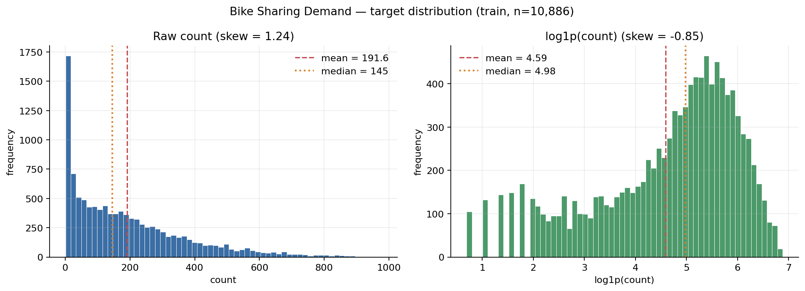
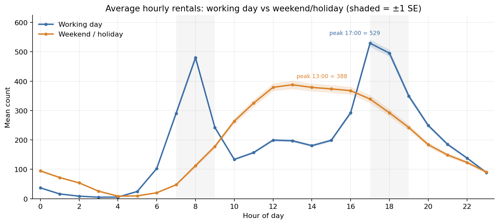
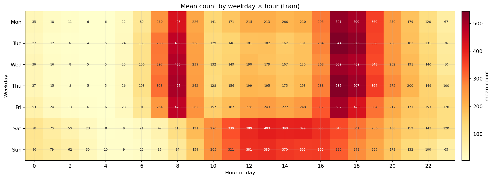
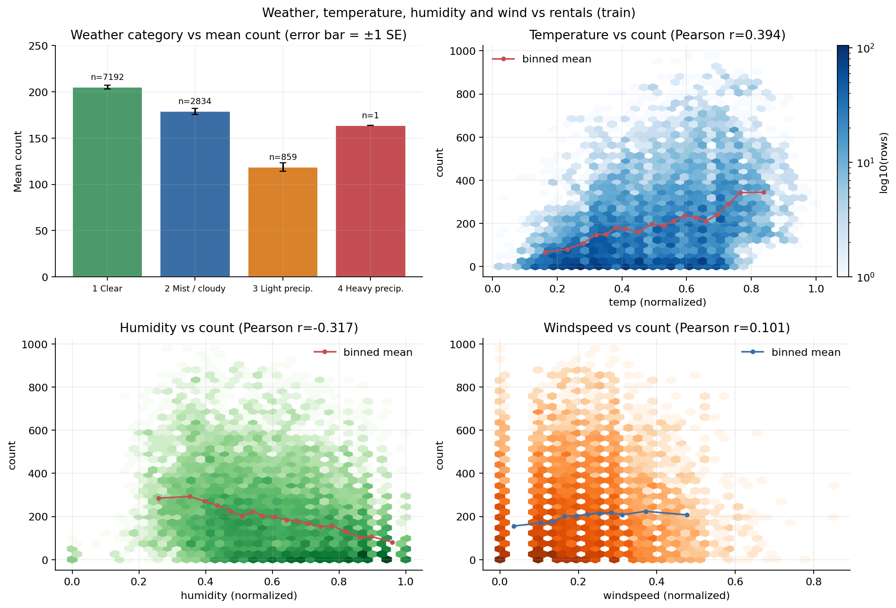
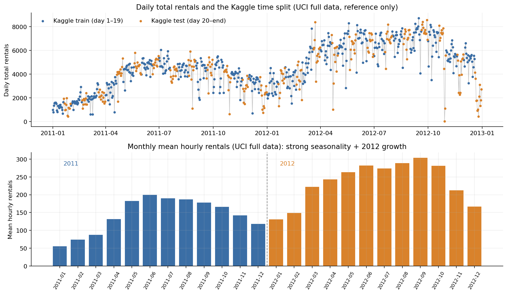
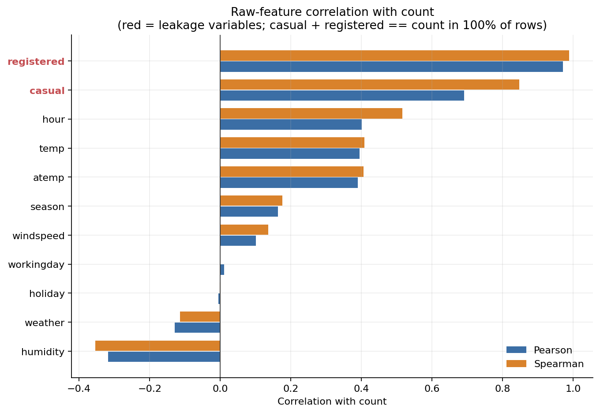

# P1 数据与特征报告：Bike Sharing Demand

- **角色**：P1（Data & Features）　**日期**：2026-11-01　**项目**：`/root/code/bike-sharing-demand`
- **任务**：小时级租车量 `count` 回归 / 时间序列预测，主指标 RMSLE
- **数据口径**：Kaggle Bike Sharing Demand；训练集 = 每月 1–19 日，测试集 = 每月 20 日–月末
- **复现**：

```bash
python3 -m src.data.make_dataset --config configs/base.yaml
python3 scripts/eda.py --config configs/base.yaml
python3 scripts/baseline.py --config configs/base.yaml
```

## 0. 摘要

1. 训练集 **10,886 行 × 12 列**，测试集 **6,493 行 × 9 列**；两者均 **0 个缺失单元格、0 个重复时间戳**。
2. 训练集覆盖 **456 个自然日**（24 个月 × 每月前 19 天），相对完整 24 小时网格少 **58 个小时**；测试集覆盖 **275 个自然日**，少 **107 个小时**。原始数据是不规则小时面板，本次不插值、不重采样。
3. `count` 均值 **191.574**、中位数 **145**、最小值 **1**、最大值 **977**、标准差 **181.144**、偏度 **1.242**；`log1p(count)` 偏度 **-0.851**，因此 P1 的线性基线在 `log1p` 空间拟合，RMSLE 也在 `log1p` 空间计算；P2 会额外比较 Poisson 原始计数目标。
4. 小时模式极强：工作日峰值 **17:00（均值 529.2）**，周末/假日峰值 **13:00（均值 387.8）**；工作日 8:00 还有 **479.9** 的通勤峰。
5. 天气 3（小雨雪）均值 **118.846**，明显低于天气 1（晴）的 **205.237**；温度 Pearson **0.3945**、湿度 **-0.3174**、风速 **0.1014**。天气 4 训练集仅 **1 行**，不能单独下结论。
6. `casual + registered == count` 在 **10,886/10,886 行（100%）** 成立；Pearson 相关 **0.6904 / 0.9709**。两者已从特征中删除，属于确定性目标泄漏。
7. 使用 `splits/time_folds.json` 的 **5 个 expanding-window 时间折**（`time_v2`），训练/验证无重叠且严格按时间先后；验证集并集 **8,196 行**（占训练集 **75.29%**），覆盖 **2011-07 至 2012-12** 的每月前 19 天；2011 上半年仅作为 fold 0 训练，不参与验证。
8. 基线 pooled OOF：Ridge **RMSLE 0.554082 / MAE 68.149 / RMSE 108.940 / R² 0.675589**；小时均值 **0.791032 / 110.411 / 164.996 / 0.255843**；全局均值 **1.448378 / 169.207 / 235.950 / -0.521812**。
9. Ridge 比小时均值基线降低 **30.0%** RMSLE，比全局均值降低 **61.7%**；fold 0 仍最难（Ridge **0.802415**，小时均值 **0.851992**），因为训练窗口只有 2011 上半年 2,690 行，验证期 2011-07..10 又发生季节切换。
10. 目标聚合诊断 `ridge_target_enc` 的 RMSLE 为 **0.603132**，比无聚合 Ridge 的 **0.554082** 差 **0.04905（+8.9%）**，fold 0 尤其明显（0.949391 vs 0.802415）；目标聚合必须在每个 fold 内重新 `fit`，且不应默认开启。

## 1. 数据来源与文件

数据来自 Kaggle **Bike Sharing Demand**，与 UCI Bike Sharing 同源。

| 文件 | 行数 | 列数 | 时间范围 | 用途 |
|---|---:|---:|---|---|
| `data/raw/train.csv` | 10,886 | 12 | 2011-01-01 00:00 – 2012-12-19 23:00 | 训练/验证 |
| `data/raw/test.csv` | 6,493 | 9 | 2011-01-20 00:00 – 2012-12-31 23:00 | 最终预测 |
| `data/raw/sample_submission.csv` | 6,493 | 2 | 与 test 对齐 | 提交格式参考 |
| `data/raw/hour.csv` | 17,379 | 17 | 2011-01-01 – 2012-12-31 | **仅 EDA/参考** |

字段：`datetime`、`season`、`holiday`、`workingday`、`weather`、`temp`、`atemp`、`humidity`、`windspeed`、`casual`、`registered`、`count`。`test.csv` 不含后三个字段。`hour.csv` 包含测试期 `cnt`，**不能用于训练、特征或调参**；本次只用于图 5 的参考趋势，未 merge 进 train/test。

## 2. 数据事实与质量

### 2.1 规模、缺失与时间覆盖

| 检查项 | 训练集 | 测试集 |
|---|---:|---:|
| 行数 | 10,886 | 6,493 |
| 列数 | 12 | 9 |
| 缺失单元格 | 0 | 0 |
| 重复 `datetime` | 0 | 0 |
| 唯一自然日 | 456 | 275 |
| 24 小时完整网格应有行数 | 10,944 | 6,600 |
| 相对完整网格缺失小时 | **58** | **107** |
| 24 小时完整的天数 | 414 | 241 |

其余天数有 23 小时（训练 36 天 / 测试 26 天）、22 小时（5 / 1 天）或更少（1 / 6 天）。**没有字段级缺失**，但存在小时级缺行；例如 2011-01 只有 431 行（19 天 × 24 小时 = 456，少 25 行）。这不是本次处理引入的，原始 Kaggle/UCI 文件即如此；当前管线保留原始时间戳，不填补，模型只对提供的行负责。

### 2.2 目标 `count`

| 统计量 | 数值 |
|---|---:|
| 均值 | 191.574 |
| 标准差 | 181.144 |
| 最小值 | 1 |
| 25% 分位 | 42 |
| 中位数 | 145 |
| 75% 分位 | 284 |
| 95% 分位 | 563.75 |
| 99% 分位 | 774.15 |
| 最大值 | 977 |
| 偏度 | 1.242 |

`count <= 10` 有 **1,229 行（11.29%）**，`count >= 500` 有 **804 行（7.39%）**；没有 0 值。`log1p(count)` 均值 **4.5914**、中位数 **4.9836**、标准差 **1.4195**、偏度 **-0.851**。原始分布右偏，取对数后更接近对称，且 RMSLE 本身在对数尺度度量误差，所以训练目标用 `log1p(count)`。

### 2.3 类别分布

| `weather` | 行数 | 占比 | 均值 `count` | 中位数 |
|---:|---:|---:|---:|---:|
| 1 晴 | 7,192 | 66.07% | 205.237 | 161 |
| 2 雾/多云 | 2,834 | 26.03% | 178.956 | 134 |
| 3 小雨雪 | 859 | 7.89% | 118.846 | 71 |
| 4 大雨雪 | 1 | 0.01% | 164.000 | 164 |

天气 4 只有 1 行，均值不具统计意义；测试集天气 4 也只有 2 行。`workingday` 0/1 为 **3,474 / 7,412** 行；`holiday` 0/1 为 **10,575 / 311** 行；`season` 1–4 为 **2,686 / 2,733 / 2,733 / 2,734** 行，基本均衡。测试集天气计数 1=4,221、2=1,710、3=560、4=2。

### 2.4 与 `count` 的相关性

Pearson / Spearman：`registered` **0.9709 / 0.9889**、`casual` **0.6904 / 0.8474**（两者为泄漏）；`hour` **0.4006 / 0.5155**、`temp` **0.3945 / 0.4080**、`atemp` 0.3898 / 0.4066、`season` 0.1634 / 0.1764、`humidity` **-0.3174 / -0.3540**、`windspeed` 0.1014 / 0.1358、`workingday` 0.0116 / -0.0004、`weather` **-0.1287 / -0.1141**、`holiday` -0.0054 / -0.0016。相关性只是边际关系，不能直接当因果。

## 3. EDA 发现

### 3.1 目标分布（图 1）



原始 `count` 右偏（偏度 1.242），长尾到 977；`log1p` 后偏度 -0.851，主体集中在 4–6。对数变换与 RMSLE 的误差定义一致：P1 的线性基线在 log 空间拟合，预测后 `expm1` 并 clip 到 0；P2 的 Poisson 模型直接拟合原始计数。

### 3.2 小时模式：工作日双峰 vs 周末单峰（图 2）



关键小时（工作日 / 周末）：08:00 **479.9 / 112.3**、12:00 199.3 / 379.1、13:00 197.2 / **387.8**、17:00 **529.2 / 339.1**、18:00 495.5 / 292.2；凌晨 03:00 为 4.9 / 25.5。工作日是通勤双峰（8:00、17:00–18:00），周末/假日是 12:00–16:00 平台单峰。`workingday` 总体均值只差 4.5（193.012 vs 188.507），但小时曲线差异巨大，说明**不能只用全局均值判断它是否有用**，必须做 `hour × workingday` 交互。

### 3.3 周 × 小时热力图（图 3）



- 全局最高格：**周二 17:00，均值 544.169**；全局最低格：**周二 03:00，均值 4.034**。
- 周一至周五的 7–9 点、17–19 点为深色高值；周六、周日的 10–18 点形成连续高值带。
- 各 weekday 日均值：周一 189.332、周二 188.137、周三 187.357、周四 196.436、周五 196.970、周六 196.665、周日 180.366。周日最低，但差异远小于小时差异。

这张图直接支撑 `hour_x_workingday` 交互特征：单独 `hour` 或单独 `workingday` 都无法表达“工作日早高峰 vs 周末午后高峰”。

### 3.4 天气、温度、湿度、风速（图 4）



- 天气 1/2/3/4 均值 **205.237 / 178.956 / 118.846 / 164.000**，样本数 **7,192 / 2,834 / 859 / 1**；天气 4 不可靠。
- 温度 Pearson **0.3945**、Spearman **0.4080**；温度升高总体伴随租车上行，但高温段（>0.8）不再继续上升，存在非线性/饱和。
- 湿度 Pearson **-0.3174**、Spearman **-0.3540**；高湿度通常对应阴雨，租车下降。
- 风速 Pearson **0.1014**、Spearman **0.1358**；关系较弱，且风速 0 值很多，分箱均值不稳定。

这些是边际关系；天气 3 的低值可能与低温、高湿度、工作日/周末构成混杂。

### 3.5 时间趋势与年度增长（图 5）



训练集按月均值从 2011-01 的 **54.645** 上升到 2012-09 的 **292.599**；2011 年（每月前 19 天）均值 **144.223**，2012 年同期均值 **238.561**，增长 **65.4%**。图 5 上半部分用 `hour.csv` 完整日总量做参考：蓝色是每月 1–19 日（Kaggle train），橙色是 20 日–月末（Kaggle test），可见测试期落在每月后半段，且 2012 年整体高于 2011 年；下半部分是完整 UCI 月度均值（仅参考），不参与建模。

这意味着：**fold 0 只有 2011 上半年 2,690 行训练，验证 2011-07..10，训练窗口最短且验证期进入夏秋**，天然更难；任何随机切分都会把未来信息泄漏进训练，导致 CV 虚高。

### 3.6 泄漏变量的直观证据（图 6）



`registered` 与 `count` 的 Pearson 为 **0.9709**，`casual` 为 **0.6904**；并且 `casual + registered == count` 在全部训练行成立。这不是“强相关特征”，而是目标的两个加数，属于确定性泄漏。任何把 `casual` 或 `registered` 放入特征的模型都会得到虚假的低 RMSLE。

## 4. 数据切分

### 4.1 Kaggle 口径

- 训练集：每月 **1–19 日**，2011-01-01 00:00 – 2012-12-19 23:00，10,886 行。
- 测试集：每月 **20 日–月末**，2011-01-20 00:00 – 2012-12-31 23:00，6,493 行。
- 两者在时间上交错：同月训练日与测试日相邻，但测试日始终在训练日之后；最终模型用全部 10,886 行训练，预测 6,493 行测试。

### 4.2 本地 5 折 expanding-window

`splits/time_folds.json`（`version=time_v2`，`strategy=expanding_month`）：

| fold | 训练行数 | 验证行数 | 训练时间 | 验证时间 |
|---:|---:|---:|---|---|
| 0 | 2,690 | 1,820 | 2011-01-01 – 2011-06-19 | 2011-07-01 – 2011-10-19 |
| 1 | 4,510 | 1,820 | 2011-01-01 – 2011-10-19 | 2011-11-01 – 2012-02-19 |
| 2 | 6,330 | 1,821 | 2011-01-01 – 2012-02-19 | 2012-03-01 – 2012-06-19 |
| 3 | 8,151 | 1,368 | 2011-01-01 – 2012-06-19 | 2012-07-01 – 2012-09-19 |
| 4 | 9,519 | 1,367 | 2011-01-01 – 2012-09-19 | 2012-10-01 – 2012-12-19 |

校验结果（`src/data/make_dataset.py`）：5 个 fold；训练/验证索引无交集；每折训练最大时间严格早于验证最小时间；训练窗口逐折扩展（后一折包含前一折全部训练行且行数增加）；验证折互不重叠，并集 **8,196 行**，覆盖 **2011-07 至 2012-12** 的每月前 19 天；训练/验证月份与更新后的 `EXPECTED_FOLD_MONTHS` / `time_v2` 一致。相比旧 split，OOF 覆盖提升到 **75.29%**。

### 4.3 为什么随机切分无效

1. 相邻小时/相邻日高度相关，随机切分会把同一时间段拆到训练和验证，模型可以“记住”邻近样本，CV 虚高。
2. 数据有强季节性和 65.4% 的年度增长；随机切分让未来信息进入训练，无法模拟“用过去预测未来”。
3. 目标聚合若全量预计算，验证折目标会进入特征；即使按折重算，随机折仍会把未来月份放进训练。
4. 与比赛口径不一致：Kaggle 训练集是每月 1–19 日，测试集是 20 日–月末；本地必须用时间切分模拟未来日期。

因此本项目只使用时间折，不做随机 KFold，也不做跨时间 shuffle。

### 4.4 本地 CV 的局限

- 验证集覆盖 **2011-07 至 2012-12** 的每月 **1–19 日**，真实测试集是 **20 日–月末**；本地 CV 不能直接评估“月末”分布。
- 2011 上半年只作为 fold 0 训练，没有验证；fold 0 训练集只有 **2,690 行（6 个月）**，是五折中训练窗口最短的。
- fold 3/4 验证期各 3 个月，验证行数 **1,368 / 1,367**，低于前三折（约 1,820）；pooled OOF 权重主要来自前三折，fold 4 不再主导。
- 测试期天气 4 只有 2 行，训练期只有 1 行；极端天气表现无法可靠估计。
- 本地 CV 是模型选择工具，不是最终 Kaggle 分数的无偏估计。

## 5. 特征工程

### 5.1 构建流程

```text
raw train/test
  -> make_dataset.py：解析 datetime、按时间排序、写 parquet、校验 10,886/6,493 行与 5 个时间折
  -> FeatureBuilder.fit(train_fold)：只用当前训练折计算目标聚合
  -> FeatureBuilder.transform(train/valid/test)：删除 datetime/count/casual/registered
  -> 模型：log1p(count) 目标，预测后 expm1 + clip(>=0)
```

### 5.2 特征分组

`FeatureBuilder(use_target_aggregates=True)` 输出 **36** 个特征；关闭目标聚合输出 **29** 个。

| 组 | 数量 | 特征 |
|---|---:|---|
| 原始数值/类别 | 8 | `season`, `holiday`, `workingday`, `weather`, `temp`, `atemp`, `humidity`, `windspeed` |
| 日历 | 7 | `year`, `month`, `day`, `hour`, `weekday`, `dayofyear`, `weekofyear` |
| 二元标记 | 3 | `is_weekend`, `is_rush_hour`（7–9、17–19 点）, `is_night`（0–5 点） |
| 周期编码 | 8 | `hour_sin/cos`, `weekday_sin/cos`, `month_sin/cos`, `dayofyear_sin/cos` |
| 交互 | 3 | `hour_x_workingday`, `temp_x_season`, `humidity_x_weather` |
| 目标聚合 | 7 | `hour_mean`, `weekday_mean`, `month_mean`, `season_mean`, `weather_mean`, `workingday_mean`, `hour_workingday_mean` |
| **合计（含/不含聚合）** | **36 / 29** | 8+7+3+8+3+7 / 8+7+3+8+3 |

`season`、`weather`、`weekday`、`month` 为 pandas `category` dtype；`hour_x_workingday` 目前是 object/字符串类别，树模型侧应转 category 或 one-hot。`feature_names` 在 `transform` 后填充。

### 5.3 目标聚合的折内安全

```text
global = mean(y_train)
agg(g) = (sum(y_train | g) + m * global) / (count(g) + m),  m = 20
```

- `fit` 只接收训练折，聚合表只由训练折目标计算；`transform` 对验证/测试行做键映射，未见分组回退到 `global`。
- 未来月份的 `month_mean` 会回退，不会读取验证目标。
- P2 做 CV 时必须每个 fold 重新 `fit`，不能在全量训练集上先算聚合再切折；最终模型才在全量 10,886 行上 fit 一次。
- 训练行上的目标聚合是样本内编码，树模型可能过拟合；本报告 Ridge 诊断显示 `ridge` 0.554082 vs `ridge_target_enc` 0.603132，目标聚合在 fold 0 显著变差（0.802415 → 0.949391），不能默认开启。

### 5.4 接口稳定性与改动记录

- `FeatureBuilder.__init__(use_target_aggregates=True, smooth=20.0)`、`fit`、`transform`、`feature_names` 签名与返回约定未变。
- **未新增特征**，未改变输出列顺序；本次只补充数据管线、EDA、基线、文档。
- 已知问题：`hour_x_workingday` 是 object dtype；`day` 在训练集只出现 1–19，测试集 20–31 属于外推区间。`day` 不泄漏目标，但树模型对它的分裂无法泛化到月末，是否保留由 P2 结合重要性决定。
- 更完整的逐特征说明见 `docs/feature_dictionary.md`。

## 6. 泄漏审计

| 检查项 | 结论 |
|---|---|
| `count` 是否入模 | 否，`DROP` 包含 `count` |
| `casual` / `registered` 是否入模 | 否，`DROP` 包含两者 |
| `casual + registered == count` | 10,886/10,886 行成立（100%） |
| 与 `count` 的 Pearson | `registered` 0.9709，`casual` 0.6904 |
| `datetime` 是否入模 | 否；只以日历/周期特征进入 |
| 目标聚合是否使用验证目标 | 否；`fit` 只接收训练行，`transform` 只做映射 |
| 目标聚合是否全量预计算 | 否；P2 必须按 fold 调用 `fit` |
| 是否使用 `hour.csv` 训练 | 否；只在图 5 做参考趋势，未 merge 进 train/test |
| 是否使用随机 KFold | 否；只用 `splits/time_folds.json` |
| 预测是否可能为负 | 统一 `clip(pred, 0, None)`；指标函数内部也会 clip |

特别提醒：`hour.csv` 包含测试期的 `cnt`。虽然 `PROJECT_SPEC.md` 允许把它用于 EDA/参考，但它**不能**作为训练数据、特征来源或调参依据；否则等于直接使用测试标签。本次只在图 5 的参考曲线中使用它，模型输入完全来自 `train.csv`/`test.csv`。

## 7. 基线结果

### 7.1 方法

| 模型 | 定义 |
|---|---|
| `global_mean` | 每个 fold 用 `expm1(mean(log1p(y_train)))` 作为常数预测；这是 RMSLE 最优常数，不是算术均值 |
| `hour_mean` | 每个 fold 按 `hour` 计算 `mean(log1p(y_train))`，验证行映射，缺失小时回退全局 |
| `ridge` | 对 `FeatureBuilder(use_target_aggregates=False)` 的 29 个特征做 one-hot（类别）+ 标准化（数值），Ridge `alpha=1.0`，目标 `log1p(count)` |
| `ridge_target_enc` | 同上，但使用 36 个特征（含目标聚合）；诊断目标聚合的影响 |

所有模型在每个 fold 内 fit，只预测该 fold 的验证行；pooled OOF 指标把 5 个验证折拼起来计算，每个验证行只出现一次。

### 7.2 Pooled OOF 指标

| 模型 | RMSLE | MAE | RMSE | R² | fold RMSLE 均值 | fold RMSLE 标准差 |
|---|---:|---:|---:|---:|---:|---:|
| `ridge` | **0.554082** | **68.149** | **108.940** | **0.675589** | 0.509743 | 0.172084 |
| `ridge_target_enc` | 0.603132 | 71.451 | 113.296 | 0.649127 | 0.538839 | 0.224115 |
| `hour_mean` | 0.791032 | 110.411 | 164.996 | 0.255843 | 0.784950 | 0.085948 |
| `global_mean` | 1.448378 | 169.207 | 235.950 | -0.521812 | 1.446567 | 0.060122 |

OOF 覆盖 **8,196 行（75.29%）**。`ridge` 比 `ridge_target_enc` 低 **0.04905 RMSLE**（后者差 **8.9%**），因此主基线选 `ridge`（无目标聚合）。

> P2 的 Ridge 使用统一的 36 特征（含目标聚合），OOF RMSLE 0.60114，与本节 `ridge_target_enc` 0.60313 接近；无聚合 Ridge 0.55408 是更公平的线性基线。

### 7.3 分 fold RMSLE

| fold | `global_mean` | `hour_mean` | `ridge` | `ridge_target_enc` |
|---:|---:|---:|---:|---:|
| 0 | 1.426199 | 0.851992 | **0.802415** | 0.949391 |
| 1 | 1.373915 | 0.668973 | 0.605046 | **0.603467** |
| 2 | 1.547726 | 0.858182 | **0.420241** | 0.420269 |
| 3 | 1.475008 | 0.854447 | 0.380142 | **0.380076** |
| 4 | 1.409989 | 0.691155 | **0.340871** | 0.340994 |

### 7.4 解读

- Ridge pooled RMSLE **0.554082**，比小时均值 **0.791032** 低 **30.0%**，比全局均值 **1.448378** 低 **61.7%**；R² **0.675589**，线性模型已能解释大部分方差。
- fold 0 最难：Ridge **0.802415**，但已优于小时均值 **0.851992**。fold 0 训练集只有 2011 上半年 **2,690 行**，验证期 2011-07..10 从春夏进入夏秋，训练窗口最短、季节切换明显；目标聚合在此折也最不稳（0.949391）。
- fold 4 最容易：Ridge **0.340871**。训练已覆盖到 2012-09（**9,519 行**），验证 2012-10..12；但 fold 4 验证行数 **1,367**，低于前三折，不能据此说它主导 pooled 指标（fold 2 的 1,821 行权重最高）。
- `global_mean` 的 R² **-0.521812** 不是代码错误：该基线在 log 空间取最优常数（OOF 预测约 58.99–93.29），而 OOF 实际均值约 216.00；它优化 RMSLE，不优化原始尺度 R²。
- 目标聚合反而拖累 Ridge（0.554082 → 0.603132）：fold 0 从 0.802415 恶化到 0.949391，fold 1/3 仅小幅改善；小训练窗口下的样本内编码容易过拟合，P2 必须按 fold 重新 fit 并做消融。

## 8. 局限与下一步

1. **本地 CV 与测试口径不一致**：验证集覆盖 2011-07 至 2012-12 的每月 1–19 日，测试集是 20 日–月末；2011 上半年只用于训练，没有验证。本地分数不能直接当 Kaggle 分数。
2. **缺失小时**：训练/测试分别少 58/107 个小时；本次不插值。若 P2 引入 lag/rolling 特征，必须按真实时间戳处理缺口，不能假设连续 24 小时。
3. **极端天气样本极少**：训练集天气 4 只有 1 行，测试集 2 行；该等级不可靠。
4. **`day` 的外推问题**：训练集只出现 1–19，测试集 20–31；树模型可能学到“day<=19”的伪分裂。建议 P2 观察 `day` 重要性，必要时在消融中删除。
5. **目标聚合的样本内过拟合**：`fit` 在训练行上计算聚合，训练特征包含自身目标信息；本次 Ridge 已显示聚合在 fold 0 明显变差（0.802415 → 0.949391）。P2 应比较 `use_target_aggregates=True/False` 的 CV，不要默认开启。
6. **`hour.csv` 的测试标签风险**：它包含测试期 `cnt`，只可用于 EDA；任何 merge 进训练/特征/调参的行为都是泄漏。
7. **基线是线性的**：Ridge 没有非线性、树交互、lag；P2 的 LightGBM 预期会更好。本报告的 0.554082 是下限参照，不是最终目标。

## 9. 复现与产物

```bash
python3 -m src.data.make_dataset --config configs/base.yaml
python3 scripts/eda.py --config configs/base.yaml
python3 scripts/baseline.py --config configs/base.yaml
```

- `data/processed/train.parquet`（10,886 × 12）、`test.parquet`（6,493 × 9），均按 `datetime` 排序；`splits/time_folds.json` 只读校验，未覆盖。
- `reports/figures/p1_*.png`：图 1 目标分布、图 2 小时曲线、图 3 weekday × hour、图 4 天气/温度、图 5 日趋势/切分、图 6 相关性；`reports/p1_eda_stats.json` 为机器可读统计。
- `reports/p1_baseline.csv`（汇总）、`p1_baseline_folds.csv`（分 fold）、`p1_baseline_oof.parquet`（8,196 行 OOF，row/y/4 个模型）。
- `docs/feature_dictionary.md`：逐特征字典与泄漏审计。

验收口径：`make_dataset` 成功校验 train 10,886 / test 6,493 / 5 folds / 无重叠 / 时间有序 / 训练窗口扩展；EDA 生成 6 张 `p1_*.png` 并输出统计 JSON；baseline 生成 4 个模型的 pooled OOF 与分 fold 指标，预测全部非负。未修改 `src/models/**`、`src/eval/**`、`reports/p2_*`、`reports/p3_*`、`configs/base.yaml`、`splits/time_folds.json`、`PROJECT_SPEC.md`、`Makefile`、`README.md`。
